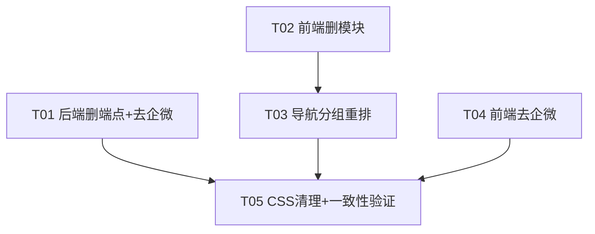

# 美团眼科运营AI助手 · 聚焦重构增量设计

> 架构师：高见远
> 目标：移除 5 个非美团模块，保留 10 个美团模块并做精准优化，导航按 REQ-01~05 重排。
> 范围：`meituan-agent.html`（3471 行）+ `server.js`（1381 行），纯删除/修改，无新增文件。

---

## 0. 关键结论（先读）

1. **switchPage 高亮逻辑无需改代码**：`switchPage(id)`（`meituan-agent.html:1672`）通过 `.s-item[data-page="..."]` 与 `.page` 做通用高亮，不含逐页 case 分支。只要保留每个导航项的 `data-page` 值不变、只删除/重排 DOM 节点，高亮逻辑自动适配。
2. **前端删除的 JS 是连续块**：`meituan-agent.html:2628`（`/* ===== PRIVATE DOMAIN ===== */`）到 `3030`（`renderGrowthPlanFallback` 结尾 `}`）为 5 个被删模块的全部函数，可整块删除，紧邻的 `3032 // ===== CLINIC COLLECT MODULE =====` 保留。
3. **后端 5 个端点是连续块**：`server.js:794`（`/api/private-domain` 注释）到 `1044`（`/api/growth-plan` 结尾 `}`），可整块删除，紧邻的 `1046 /api/clinic-analysis` 保留。被删端点内部**没有**被保留端点复用的私有 helper（仅用了共享的 `delay/randInt/pick/CLINIC`，均保留）。
4. **CSS 死代码是连续块**：`meituan-agent.html:337`（`.script-bubble-new`）到 `375`（`.copy-btn-sm:hover`）全部只被 5 个被删模块使用，可整块删除；`335/336`（`.script-section/.script-section-title`）被保留模块 `meituan-ops` 使用，**必须保留**。
5. **"企微"清理范围明确**：后端 2 处（删 1 条话术 + 改 1 处 desc），前端 4 处（改 2 处文案 + 删 2 个"分享到企微"按钮）。

---

## 1. 需要删除的前端代码块清单（meituan-agent.html）

### 1.1 导航项（sidebar s-item，5 项）

| 模块 | 导航项行号 | 内容 |
|------|-----------|------|
| 私域运营 | 669–671 | `data-page="private-domain"` |
| 抖音策略 | 672–674 | `data-page="douyin"` |
| 小红书 | 675–677 | `data-page="xiaohongshu"` |
| 公众号 | 678–680 | `data-page="wechat"` |
| 增长策略 | 681–683 | `data-page="growth"` |

> 删除方式：在 `T03` 重排导航时，整段重写 `644–693` 的 `<nav class="s-nav">` 内容，等价于"删除 5 项 + 重排其余 10 项 + 新增分组 s-label"。

### 1.2 页面 section（5 个，含注释块）

| 模块 | section id | 注释行 | section 行号范围 |
|------|-----------|-------|-----------------|
| 私域运营 | page-private-domain | 1046 | 1047–1059 |
| 抖音策略 | page-douyin | 1061 | 1062–1074 |
| 小红书 | page-xiaohongshu | 1076 | 1077–1089 |
| 公众号 | page-wechat | 1091 | 1092–1104 |
| 增长策略 | page-growth | 1106 | 1107–1119 |

**删除行号区间：1046–1120**（含 5 个注释块 + 5 个 section + 末尾空行 1120），保留 1045 空行与 1121 `<!-- ===== PAGE: CLINIC COLLECT ===== -->` 之间恰好一个空行。

### 1.3 JS 函数（5 组，15 个函数 + 1 个注释头）

| 模块 | 函数 | 位置 |
|------|------|------|
| 私域运营 | runPrivateDomain | 2629 |
| | renderPrivateDomain | 2642 |
| | renderPrivateDomainFallback | 2693 |
| 抖音 | runDouyinPlan | 2714 |
| | renderDouyinPlan | 2727 |
| | renderDouyinPlanFallback | 2774 |
| 小红书 | runXiaohongshuPlan | 2791 |
| | renderXiaohongshuPlan | 2804 |
| | renderXiaohongshuPlanFallback | 2844 |
| 公众号 | runWechatPlan | 2860 |
| | renderWechatPlan | 2873 |
| | renderWechatPlanFallback | 2915 |
| 增长策略 | runGrowthPlan | 2933 |
| | renderGrowthPlan | 2946 |
| | renderGrowthPlanFallback | 3006 |

**删除行号区间：2628–3031**（`/* ===== PRIVATE DOMAIN ===== */` 注释头 到 `renderGrowthPlanFallback` 结尾 `}` 3030，外加 3031 空行），保留 3032 `// ===== CLINIC COLLECT MODULE =====`。

> 被删函数内的 `callAPI('/private-domain'|'/douyin-plan'|'/xiaohongshu-plan'|'/wechat-plan'|'/growth-plan')` fetch 调用一并随之删除（分别在 2633/2718/2795/2864/2937）。

### 1.4 CSS 专属死代码（见 §5 全局一致性，删除行号 337–375 + 修改 461）

---

## 2. 需要删除的后端端点清单（server.js）

| 模块 | 端点 | 注释行 | handler 行号范围 |
|------|------|-------|-----------------|
| 私域运营 | /api/private-domain | 794 | 795–848 |
| 抖音策略 | /api/douyin-plan | 850 | 851–899 |
| 小红书 | /api/xiaohongshu-plan | 901 | 902–942 |
| 公众号 | /api/wechat-plan | 944 | 945–984 |
| 增长策略 | /api/growth-plan | 986 | 987–1044 |

**删除行号区间：794–1045**（含 5 个注释块 + 5 个 handler + 末尾空行 1045），保留 793 空行与 1046 `/api/clinic-analysis` 之间恰好一个空行。

> 这 5 个 handler **内部均无独立 helper 函数**，只用共享的 `delay()/randInt()/pick()/CLINIC`（`server.js:33/34/35/21`），这些被保留端点继续使用，**不删除**。`parseCompetitorText()`（117）仅供 `/api/competitor-analysis`（保留）使用，**不删除**。

---

## 3. 保留模块的精确优化点

### 3.1 话术建议（script）——清理"企微"，保留"美团评价引导"

**后端 `server.js`：**

| 位置 | 动作 | 现状 → 目标 |
|------|------|------------|
| 503–509 | 删除整个 `scripts.push({ name:'企微预约确认', ... })` 块 | 删除"企微预约确认"话术条目（name/desc/text 均为企微渠道） |
| 585 | 修改 `desc` | `'就诊后48小时企微发送'` → `'就诊后48小时发送'`（保留其 text 中"能在美团给我们留个评价吗？"的美团评价引导内容） |

**前端 `meituan-agent.html`：**

| 位置 | 动作 | 现状 → 目标 |
|------|------|------------|
| 1366 | 修改 `SCRIPTS` 数据 `desc` | `desc:'就诊后48小时企微发送'` → `desc:'就诊后48小时发送'` |
| 2299 | 删除整行"分享到企微"按钮 | `renderScriptCardsFromData` 中移除 `'<button ...>分享到企微</button>' +` |
| 2316 | 删除整行"分享到企微"按钮 | `renderScriptCards`（本地模板）中移除 `'<button ...>分享到企微</button>' +` |

### 3.2 评价管理（review）——清理 SOP 卡"企微"

| 位置 | 动作 | 现状 → 目标 |
|------|------|------------|
| 1004 | 修改 `sop-title` | `离院后2小时企微发送` → `离院后2小时发送`（sop-desc 中"点击评价链接为我们5分好评"为美团内容，保留） |

### 3.3 其余保留模块——本期维持现状（无代码改动）

- **dash 首页仪表盘**：维持现状（REQ-01）。
- **clinic-collect 门诊采集**：定位为数据采集入口（REQ-01），维持现状。
- **comp 竞品分析**：竞争定价（REQ-02），维持现状。
- **copy 文案生成 / img 套图生成 / img-diagnosis 主图诊断 / copy-optimize 文案优化**：素材智能生成（REQ-03），维持现状。
- **meituan-ops 美团运营诊断**：运营与流量决策（REQ-05），维持现状。

---

## 4. 导航分组实现方案

### 4.1 是否新增分组标签 s-label

**是**。当前只有一个 `.s-label`（`645 导航菜单`）。重构后需 5 个分组标签。`.s-label` 的 CSS（`99`）已存在且支持多组，无需新增 CSS；`switchPage` 高亮只匹配 `.s-item`，不会误伤 `.s-label`。

### 4.2 重写 `644–693` 的 `<nav class="s-nav">` 内容

删除原 645–692 全部子节点，替换为：

```html
<div class="s-label">经营驾驶舱</div>
<div class="s-item active" data-page="dash" onclick="switchPage('dash')">
  <span class="s-item-icon">&#9638;</span><span>首页仪表盘</span>
</div>
<div class="s-item" data-page="clinic-collect" onclick="switchPage('clinic-collect')">
  <span class="s-item-icon">&#127973;</span><span>门诊采集</span>
</div>

<div class="s-label">经营分析与竞争定价</div>
<div class="s-item" data-page="comp" onclick="switchPage('comp')">
  <span class="s-item-icon">&#9673;</span><span>竞品分析</span>
</div>

<div class="s-label">素材智能生成</div>
<div class="s-item" data-page="copy" onclick="switchPage('copy')">
  <span class="s-item-icon">&#9998;</span><span>文案生成</span>
</div>
<div class="s-item" data-page="img" onclick="switchPage('img')">
  <span class="s-item-icon">&#9635;</span><span>套图生成</span>
</div>
<div class="s-item" data-page="img-diagnosis" onclick="switchPage('img-diagnosis')">
  <span class="s-item-icon">&#128269;</span><span>主图诊断</span>
</div>
<div class="s-item" data-page="copy-optimize" onclick="switchPage('copy-optimize')">
  <span class="s-item-icon">&#9997;</span><span>文案优化</span>
</div>

<div class="s-label">评价智能管理</div>
<div class="s-item" data-page="review" onclick="switchPage('review')">
  <span class="s-item-icon">&#9733;</span><span>评价管理</span>
  <span class="s-item-badge">1</span>
</div>

<div class="s-label">运营与流量决策</div>
<div class="s-item" data-page="meituan-ops" onclick="switchPage('meituan-ops')">
  <span class="s-item-icon">&#9874;</span><span>美团运营诊断</span>
</div>
<div class="s-item" data-page="script" onclick="switchPage('script')">
  <span class="s-item-icon">&#9994;</span><span>话术建议</span>
  <span class="s-item-badge">3</span>
</div>
```

### 4.3 switchPage 高亮逻辑

`switchPage(id)`（1672–1683）无需改动，原因：`data-page` 值全部保留（dash/comp/copy/img/script/review/meituan-ops/clinic-collect/img-diagnosis/copy-optimize），仅删除已移除页面的导航项并重排顺序。`dash` 仍带 `active` 类作为默认页，与 `page-dash` 的 `active`（702）一致。

---

## 5. 全局一致性检查清单（删除后必须逐项验证）

### 5.1 前端残留引用检查

- [ ] `switchPage('private-domain'|'douyin'|'xiaohongshu'|'wechat'|'growth')` 无残留（仅原导航项 669–683 有此调用，已删；dashboard 快捷操作 765/769/773/777 只指向 comp/copy/img/script，均为保留页）。
- [ ] `runPrivateDomain/runDouyinPlan/runXiaohongshuPlan/runWechatPlan/runGrowthPlan` 5 个函数无残留定义、无残留 onclick 引用（对应 section 已一并删除）。
- [ ] `callAPI('/private-domain'|'/douyin-plan'|'/xiaohongshu-plan'|'/wechat-plan'|'/growth-plan')` 无残留（仅存在于被删函数内）。
- [ ] `getElementById('privateDomainResult'|'douyinPlanResult'|'xiaohongshuPlanResult'|'wechatPlanResult'|'growthPlanResult')` 无残留（仅存在于被删函数内）。

### 5.2 CSS 死代码清理（前端 337–375 + 461）

删除以下**仅被 5 个被删模块使用**的选择器（337–375 连续块）：

| 行号 | 选择器 | 被删模块的使用点 |
|------|--------|-----------------|
| 337 | `.script-bubble-new` | private-domain/douyin/xiaohongshu/wechat |
| 338–342 | `.sop-timeline/.sop-time-item/.sop-time-dot` | private-domain |
| 343–348 | `.layer-table*` | private-domain |
| 349–352 | `.calendar-row/.calendar-day/.calendar-topic/.calendar-type` | douyin/xiaohongshu/wechat |
| 353–357 | `.funnel-*` | growth |
| 358–363 | `.roi-table*` | growth |
| 364–366 | `.experiment-*` | growth |
| 367–370 | `.menu-tree/.menu-col*` | wechat |
| 371–373 | `.tag-sm/.tag-sm-p0/.tag-sm-p1` | growth |
| 374–375 | `.copy-btn-sm/.copy-btn-sm:hover` | private-domain/douyin/xiaohongshu/wechat |

**注意边界**：`335 .script-section`、`336 .script-section-title` 被保留模块 `renderMeituanOps`（2572/2585/2590）使用，**必须保留**，不要一并删除。

**联动修改 461**（响应式）：将
`.clinic-project-table,.comp-table,.layer-table,.roi-table{...}` 改为 `.clinic-project-table,.comp-table{...}`（移除已删的 `.layer-table,.roi-table`）。

### 5.3 后端残留检查

- [ ] 无 `/api/private-domain|/api/douyin-plan|/api/xiaohongshu-plan|/api/wechat-plan|/api/growth-plan` 的 `app.post` 定义残留。
- [ ] 前端无 fetch 调用这 5 个端点（对应 5.1 已核）。
- [ ] `CLINIC/delay/randInt/pick/parseCompetitorText` 等共享工具保留（被保留端点复用）。
- [ ] `node -c` 或 `node --check server.js` 语法通过。

### 5.4 "企微"表述清零检查（保留模块内）

- [ ] 前端：`1366` desc、`1004` sop-title 已改；`2299/2316` 两个"分享到企微"按钮已删。
- [ ] 后端：`503–509` 企微预约确认已删；`585` desc 已改。
- [ ] 全库 grep `企微|企业微信`：仅允许出现在**已删除**的 private-domain/growth 源码内（删除后应无命中）；保留模块（script/review/meituan-ops/dash 等）零命中。

### 5.5 运行时冒烟验证

- [ ] `node server.js` 正常启动，无端口/语法错误。
- [ ] 浏览器打开页面：侧栏显示 5 个分组、10 个菜单项；点击每个菜单能正确切换且高亮正确。
- [ ] 话术建议页：切换各场景正常，无"企微预约确认"条目，无"分享到企微"按钮；"离店跟进"场景的 desc 为"就诊后48小时发送"，正文含"能在美团给我们留个评价吗"。
- [ ] 评价管理页：好评 SOP 卡第 2 步标题为"离院后2小时发送"。
- [ ] 控制台无 `undefined function` / `Cannot read property of null` 报错。

---

## 6. 任务列表（有序，含依赖）

> 说明：本项目仅 2 个文件（前端单文件 + 后端单文件），"≥3 文件/任务"的粒度规则不适用，此处以"文件 + 行号区间"作为最小交付单元。任务间依赖已最小化（T01/T02/T04 可并行）。

### T01（P0）后端：删除 5 个非美团端点 + 话术去企微
- **操作类型**：删除 + 修改
- **目标文件**：`server.js`
- **具体动作**：
  1. 删除 794–1045（`/api/private-domain`、`/api/douyin-plan`、`/api/xiaohongshu-plan`、`/api/wechat-plan`、`/api/growth-plan` 的注释块 + handler + 末尾空行）。
  2. 删除 503–509（`script-suggest` 中 `企微预约确认` 的 `scripts.push({...})` 整块）。
  3. 修改 585：`desc: '就诊后48小时企微发送'` → `desc: '就诊后48小时发送'`。
- **依赖**：无
- **优先级**：P0

### T02（P0）前端：删除 5 个非美团模块（HTML section + JS 函数）
- **操作类型**：删除
- **目标文件**：`meituan-agent.html`
- **具体动作**：
  1. 删除 1046–1120（5 个 `<section>` + 各自注释块 + 末尾空行）。
  2. 删除 2628–3031（`/* ===== PRIVATE DOMAIN ===== */` 至 `renderGrowthPlanFallback` 结尾，含 5 组共 15 个函数及其 fetch 调用）。
- **依赖**：无
- **优先级**：P0

### T03（P0）前端：导航分组重排（sidebar 重写 + 高亮确认）
- **操作类型**：修改（删除 + 新增 s-label + 重排）
- **目标文件**：`meituan-agent.html`
- **具体动作**：
  1. 重写 644–693 的 `<nav class="s-nav">` 内容为 §4.2 的 5 分组结构（删除 private-domain/douyin/xiaohongshu/wechat/growth 的导航项，重排其余 10 项，新增 5 个 `.s-label`）。
  2. 确认 `switchPage`（1672–1683）无需改动（`data-page` 值全保留）。
- **依赖**：T02（先删导航项对应的 section，再重排，避免短暂残留）
- **优先级**：P0

### T04（P1）前端：保留模块去"企微"表述
- **操作类型**：修改 + 删除
- **目标文件**：`meituan-agent.html`
- **具体动作**：
  1. 修改 1366：`SCRIPTS` 中 `desc:'就诊后48小时企微发送'` → `desc:'就诊后48小时发送'`。
  2. 删除 2299（`renderScriptCardsFromData` 中"分享到企微"按钮整行）。
  3. 删除 2316（`renderScriptCards` 中"分享到企微"按钮整行）。
  4. 修改 1004：`离院后2小时企微发送` → `离院后2小时发送`。
- **依赖**：无（仅触碰保留模块 script/review，与 T01/T02 无耦合）
- **优先级**：P1

### T05（P1）前端：CSS 死代码清理 + 全局一致性验证
- **操作类型**：删除 + 修改 + 验证
- **目标文件**：`meituan-agent.html`（+ 交叉校验 `server.js`）
- **具体动作**：
  1. 删除 337–375（§5.2 表中 14 组死选择器连续块）。
  2. 修改 461：移除 `.layer-table,.roi-table`。
  3. 逐项执行 §5 全局一致性检查清单（5.1–5.5），含 `node --check server.js`、浏览器冒烟、`企微|企业微信` 全库 grep 清零。
- **依赖**：T01、T02、T03、T04
- **优先级**：P1

---

## 7. 任务依赖图



---

## 8. 共享知识（写给工程师的横切约定）

- 行号以本次勘察时的文件版本为准；若在编辑过程中行号漂移，以 §1–§5 中给出的**内容锚点**（注释头、函数名、选择器名）为准定位。
- 删除一律"整块删除"，不留空注释、不留孤立的 `var container = document.getElementById('xxxResult')` 之类死引用。
- 修改 desc/文案时**只替换"企微/企业微信"字样**，不动美团相关正文（如"能在美团给我们留个评价吗""点击评价链接为我们5分好评"）。
- 保留模块的 CSS 选择器 `.script-section/.script-section-title`（335/336）不可删，避免误伤 `meituan-ops` 诊断页渲染。
- 每完成一个任务建议立即 `node --check server.js`（后端）或浏览器刷新冒烟（前端），便于定位回归。
